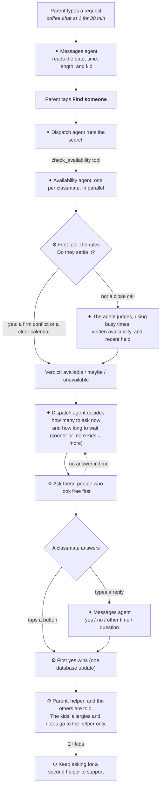

# Village

Short-notice kid care from SOM classmates you trust.

A parent messages Village something like *"I have a coffee chat at 1 for 30 min and need someone to hang out with my kid"*. Village checks the calendars of the classmates in that parent's approved "village", asks only the ones who look free, and books the first one who says yes. It's peer coordination between classmates, not a childcare service.

## Two versions

Both run from the same app with the same agents and database.

| | **1. Web demo** (for graders) | **2. Slack** (the real product, shown in the demo video) |
|---|---|---|
| What it is | A Slack-like chat in your browser with made-up classmates | A Slack bot real classmates message |
| What you need | Python + `PORTKEY_API_KEY` | The same, plus a Slack workspace and two tokens |

**Graders: we suggest the web demo.** It runs with one command, and every Slack feature works the same way there. The Slack version works too if you'd like to try it: create a free Slack workspace and add your own two Slack tokens (see [Version 2: Slack](#version-2-slack)).

**Demo video (Slack version):** https://drive.google.com/file/d/1n0DXS_W_FDBVc_C9_sLhEK-Xdpzbx4x5/view?usp=sharing

## How it works



✦ = an agent (gpt-6-luna). ⚙ = code. A fourth agent, **setup**, reads what people type when they set up their profile (their kids, or when they're free).

Four agents, each for one kind of job:

| Agent | Job | Tools | Output |
|---|---|---|---|
| Messages | Reads anything typed in the chat. A parent's message → date, time, length, child. A classmate's typed answer to an ask → yes / no / other time / question | `get_draft_request` | `IntakeResult` or `ReplyIntent` |
| Availability (one per villager) | Decides whether to ask this villager: runs the rules first, and judges only what they can't settle (tight handoffs, tentative events, vague written availability) | `screen_with_rules`, `get_calendar_busy_times`, `get_stated_availability`, `get_recent_help` | `AvailabilityVerdict` |
| Dispatch | Runs the search. On a new request it spins up the availability agents (one per classmate, in parallel) and reads their verdicts. Then, before each round of asks, it decides how many classmates to ask at once and how long to wait before asking more, based on how soon the care starts, how many kids, who looks free vs. maybe, and whether it's a search for cover or a second helper. Code keeps it within bounds, and falls back to 3 at a time if it fails | `check_availability` | `DispatchPlan` |
| Setup | Reads what people type while setting up their profile. A parent's kids → names, ages, allergies, general notes (asks rather than guessing an unclear age). A classmate's written availability → weekly time slots, once, when saved | none | `KidsReading` or `ParsedAvailability` |

| Tool | Agent | What it returns | Why the agent uses it |
|---|---|---|---|
| `get_draft_request` | Messages | The request the parent is still confirming (child, start time, length, purpose, place), from the `requests` table. Nothing for a classmate's answer | So a follow-up like *"actually make it 45 min"* changes the existing request instead of starting a new one |
| `check_availability` | Dispatch | Starts one availability agent per classmate in parallel and returns each verdict (available / maybe / unavailable) and its reason | So the agent running the search sees who looks free before deciding how many to ask. Code checks anyone it skips, so no one is asked without a verdict |
| `screen_with_rules` | Availability | Village's fixed rules (`backend/screening.py`) applied to this villager: a settled verdict (a firm conflict, a clear calendar) or "not settled" | Called first, so clear cases end right away and the agent only judges real close calls. Code makes sure it never contradicts a settled case |
| `get_calendar_busy_times` | Availability | Busy times on the request day from all of the classmate's connected calendars, merged, with tentative events marked and any calendar that failed to load. No event titles | To judge close calls the rules can't settle, like a class ending right at the handoff or a tentative meeting |
| `get_stated_availability` | Availability | What the classmate wrote about when they're free (marked as untrusted), plus the weekly slots and caveats the setup agent parsed from it | For classmates with no calendar, or whose note adds context, like *"I'd skip a club meeting for this"* |
| `get_recent_help` | Availability | How many times the classmate has helped this week, from the `users` table | So its explanation can note when someone has already helped a lot. It's never a reason to say no; spreading asks around is done by code |

The setup agent has no tools on purpose: it reads text people typed, so it can only fill in fields, and an instruction hidden in that text has nothing to act on. The messages agent's one tool only reads the parent's own draft request, and returns nothing when it's reading a classmate's answer.

All agents use **gpt-6-luna** through Portkey. Messaging, booking, and sharing the child's allergies and notes are done by code (`backend/coordinator.py`), never by an agent.

## Using Village

Everything happens in a direct message with Village, plus its **Home** tab for editing your profile.

- **Set up:** parents describe their kids in their own words (allergies and notes too) and pick who's in their village. Classmates connect a calendar or say when they're free.
- **Ask (parents):** say what you need in plain words, for one kid or several. Village confirms the time, then asks classmates who look free. With two or more kids, the first yes is booked as the main caretaker, and Village keeps looking for a second person to support.
- **Help (classmates):** tap **Yes, I can** or **Can't this time**, or reply in your own words. The first yes is booked and gets the kid's allergies and notes.
- **Back out:** tap **I can't make it anymore** (**Something came up** with under 6 hours to go). Village quietly looks for someone else to cover first (see the rules below).

## Version 1: web demo

### Run it

Needs **Python 3.11+**. Node isn't needed; the built frontend is in `frontend/dist`.

```bash
pip3 install -r requirements.txt
```

```bash
cp .env.example .env
```

Set `PORTKEY_API_KEY` in `.env` (skip this if it's already in `../.env`; the app checks this folder first, then one level up).

```bash
python3 backend/main.py
```

Open **http://localhost:8000** (or set another port, e.g. `PORT=8010 python3 backend/main.py`). The first start builds the database, `data/village.db`, from the demo data in `data/seed/`. **Reset demo** rebuilds it. The database itself isn't in the repo, since a running copy holds real users' Slack accounts and calendar links.

### The demo

Two windows each show one person in a fake Slack workspace (Village is under **Apps**). The **People** tab on the right lists everyone in three groups with how each is set up right now; open anyone in either window from there or from **Signed in as**. After a start or **Reset demo**:

| Group | Who | How they start |
|---|---|---|
| Parents | **Priya** | Arjun, 4. Villagers: Sam, Mei, Hannah (invited). |
| Classmates | **Sam** | In Priya's village. Connected to demo calendars. |
| | **Mei** | In Priya's village. Connected to demo calendars. Availability described. |
| | **Hannah** | Invited to Priya's village. Connected to demo calendar. |
| New to Village | **Marcus**, **Diego**, **Jordan** | Not set up yet. |

The set-up people's chats show the setup conversation they had. New people's chats start with Village's intro and its first question, the same message every new person gets. Real Slack users aren't listed and can't be played here.

**+ New classmate** adds a brand-new person with no demo calendar; they get the same intro. **Reset demo** puts everyone back as in the table, with no help history. It also starts any real Slack users over from setup and sends them the intro in Slack, so don't reset while classmates are using it.

**Demo calendars:** each made-up person has fake calendars (`.ics` files in `data/seed/calendars/`), with events that repeat daily so the demo works on any day. During setup they can be connected with **Use my demo calendar (demo only)**.

**Rules:**
- Commitments up to 80 minutes, plus a 5-minute handoff on each side.
- People who look free are asked before "maybes", then whoever has helped least this week. The dispatch agent decides how many to ask at once and how long to wait before asking more: more people and shorter waits when it's last-minute, for more than one kid, or when finding cover.
- When a helper can't make it, they stay booked while Village quietly asks the rest of the village; if someone takes over, the parent just gets a note. With 6–24h to go they confirm first. If no one can cover: with 6h+ notice they can cancel and the parent is told; under 6h they can't cancel and are asked to message the parent directly. Once the care time has started, it's too late to back out.
- Anyone who said no or is already helping isn't asked again that day.

### Demo vs. real use

| | Web demo | Real use (Slack) |
|---|---|---|
| People | Made-up classmates; you play all of them | Each classmate on their own Slack account |
| Calendars | Demo calendar files, connected from the seed or with one tap during setup (real links and written availability work too) | Their own private calendar link from Google or Outlook, or written availability |
| Starting point | Some people already set up, some new (see the table above) | Everyone sets up when they first join |
| Picking a village | A list of the demo people (real Slack users can be invited too) | Slack's people picker |
| Messages | Appear in the browser windows | Slack DMs from the Village bot |
| Reset | **Reset demo** restores the starting point | No reset; people edit their profile on the Home tab |

Both use the same agents, rules, and real clock. The demo calendars repeat daily so the demo works on any day.

## Version 2: Slack

The bot runs inside the same app via Slack's Socket Mode, so no hosting is needed, but it's only online while the app runs.

1. Do the first two steps of [Run it](#run-it).
2. Create a free workspace at https://slack.com/get-started (or use your own).
3. At https://api.slack.com/apps: **Create New App** → **From an app manifest** → paste [`slack/manifest.yml`](slack/manifest.yml).
4. **Basic Information** → **App-Level Tokens** → generate one with scope `connections:write` (starts with `xapp-`).
5. **Install App** → **Install to Workspace** → copy the **Bot User OAuth Token** (starts with `xoxb-`).
6. Add both to `.env` as `SLACK_APP_TOKEN` and `SLACK_BOT_TOKEN`, then run `python3 backend/main.py`. It prints `Slack: connected`.
7. Invite classmates. Village messages each new person when they join and walks them through setup (see [Using Village](#using-village)).

**Testing Slack on your own computer:** if you're a parent in Slack, your Home tab has a **🧪 Testing only** section for adding demo people (Sam, Mei, Hannah…) to your village. They live in the web demo, so open http://localhost:8000 in your browser and answer for them there. That way you can try the whole flow in Slack by yourself.

## Tests

```bash
python3 -m pytest
```

`test_rules.py` and `test_slack_setup.py` need no model or Slack connection. `test_agents_live.py` calls gpt-6-luna (full flows, prompt-injection defenses, how the setup agent reads kids' names and ages, how dispatch sizes a round) and needs `PORTKEY_API_KEY`; skip it with `-m "not live"`. Tests use their own copy of the demo data in `tests/seed/`.

## Project layout

```
backend/          FastAPI app; coordinator.py (workflow), onboarding.py (setup chat),
                  agents/ + prompts/, screening.py (rules), calendars.py, channels/ (web + Slack)
frontend/         React + TypeScript + Vite (built copy in frontend/dist)
data/seed/        demo people and calendars
tests/            pytest suite
slack/            Slack app manifest
docs/             report.html and slides.html (self-contained; screenshots and charts embedded)
scripts/, output/ measure_caching.py and trace_run.py, with results (caching_experiment.md, traced_run.md);
                  every agent run's tokens and cost are logged locally to output/audit_log.jsonl and /api/usage
```

## Safety

- **Privacy:** a real calendar is stored only as its private link. Village downloads it when checking availability, keeps only busy times in memory, and never saves event details, so agents never see event names. A child's allergies and notes go only to the helper, after they say yes; the only agent that reads them is the setup agent, once, while the parent types them in. Add-to-calendar links are signed and leave them out.
- **Prompt injection:** classmates' text is marked as untrusted data in every prompt. The setup agent has no tools, the messages agent's only tool reads the parent's own draft, the availability agent's tools only read that one classmate's data and can't overrule the rules, and booking is done by code.
- **Real Slack users in the web demo:** the demo only plays the made-up people. Slack users aren't in its people lists, the API refuses to read or act for them, and their requests stay out of Behind the scenes. Demo parents can still invite them to a village, for testing alone.
- **Double booking:** the first yes wins in one conditional database update.
- **Cost:** per-agent limits, dispatch's plan kept within bounds (with a simple fallback rule), low reasoning effort for the availability agent, a 30-second timeout per availability check (the rules' answer is used if it times out), and a token budget per request.
- **Calendar links:** https only, no private network addresses, 5 MB cap.
